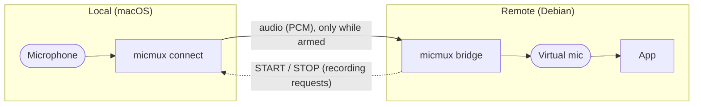

# micmux

[日本語](./README.ja.md)

> On-demand microphone forwarding over SSH, independent of terminals and applications.

micmux lets you use the microphone on your SSH client machine as a virtual microphone on the remote host.
The local microphone turns on only at the moment an app on the remote host starts recording, and turns off when recording ends.



Both arrows between `micmux connect` and `micmux bridge` travel over one SSH connection (the standard input and
output of `ssh`).

Audio travels on a path separate from the terminal's input and output (a dedicated SSH connection, or a separate
channel on a multiplexed one), so micmux does not depend on tmux or the terminal emulator.

The specification and design decisions are in [`prd/`](./prd/), and the history of decisions is in
[`prd/_grilling/decisions.md`](./prd/_grilling/decisions.md). The guide for agents that help with development is
[`AGENTS.md`](./AGENTS.md). These design documents, as well as the issues, are written in Japanese.

## Status

As of 2026-11-27. Voice input into Claude Code from macOS to Debian over a real SSH connection has been confirmed.

| Item | Status |
|---|---|
| Claude Code 2.1.332 records from the virtual mic inside SSH + tmux and transcribes the speech | Confirmed by testing |
| Start and end of recording are detected from the presence of PulseAudio recording streams | Confirmed by testing |
| Requests are denied while disarmed / accepted after arm | Confirmed by testing |
| The remote host is restored after the local side crashes, the terminal is closed, or the bridge receives SIGTERM | Confirmed by testing |
| Microphone capture on macOS (Core Audio) | Confirmed by testing. Also works on Linux (ALSA) |
| Forwarding over a real SSH connection, and transcription of Japanese speech | Confirmed by testing |
| Automatic start from `LocalCommand`, running in the background | Confirmed by testing on macOS |
| Sharing the connection with `--mux` (authenticate once), starting from `Match exec` | Confirmed by testing on macOS with a fingerprint-protected key |
| Microphone permission when running in the background | Confirmed by testing on macOS (same level as when run directly from the terminal) |
| PulseAudio 17.0 on the remote host | Confirmed by testing. Audio from the virtual mic arrives 1–2 seconds late, though (see Known limitations) |
| PipeWire 1.4.2 on the remote host (Debian 13) | Confirmed by testing. The remote host in daily use runs this |
| PipeWire 1.6.x on the remote host | Passes the end-to-end test in CI and in containers (1.6.2, 1.6.9, 1.6.11). Not tested on a real remote host |
| Codex CLI | Not tested. The 0.162.1 Linux binary appears to have no recording implementation (see below) |

## Setup

### Remote host (Debian)

Install the audio stack. You can review the current state with `--check` before changing anything.

```sh
./scripts/setup-debian-server.sh --check
./scripts/setup-debian-server.sh
```

Build micmux and put it on PATH. Building on the remote host does not need any audio development headers.

```sh
cargo install --path .
micmux doctor
```

### Local machine (macOS)

```sh
cargo install --path .
```

The first time you record, macOS asks for permission for your terminal app to access the microphone.

## Usage

On the local machine:

```sh
micmux connect dev-server --set-default
```

micmux starts **disarmed** (it denies all recording requests). Press Enter to toggle between armed and disarmed.
From another terminal or a key binding, use these commands:

```sh
micmux arm
micmux disarm
micmux toggle
micmux status --json
```

On the remote host, use your apps inside SSH + tmux as usual. In Claude Code, enable voice input with `/voice`;
it records while you hold down the space bar.

### Starting automatically with ssh

Add two lines to `~/.ssh/config`, and `ssh dev-server` starts micmux in the background; it exits when that
SSH session closes. You no longer need to run `micmux connect` in a separate terminal.

```
Host dev-server
    PermitLocalCommand yes
    LocalCommand micmux connect %n --set-default --background --watch-pid $PPID
```

- If micmux is not on PATH on the remote host, add `--remote-cmd '~/.cargo/bin/micmux'`
  (non-interactive SSH sessions may not read your login shell configuration).
- If you open several SSH sessions to the same host, the second and later ones join the running micmux.
  micmux exits when all of them have ended. However, if they join a micmux you started by hand from a terminal
  without `--watch-pid`, micmux keeps running after those SSH sessions end.
- micmux starts disarmed. Allow recording with `micmux arm` / `micmux toggle`
  (binding them to keys is convenient). While running in the background, denied requests show up only in
  the log, so they are easy to miss. Add `--armed` to allow recording from the start.
- While running in the background, messages go to `~/.local/state/micmux/client.log` (created readable only by you).
  If it is larger than 1 MB at startup, it is moved to `client.log.1` and started anew. If neither `XDG_STATE_HOME`
  nor `HOME` is set, the log location cannot be determined, so micmux does not start unless you specify `--log`.
- There is no terminal, so micmux cannot ask for a passphrase. Load your key into ssh-agent.
- `LocalCommand` also runs when `git` or `scp` connects to that host. In that case micmux exits as soon as
  the connection ends.

### Authenticating only once

micmux opens an SSH connection separate from the terminal's, so by default you authenticate twice.
If your key requires a fingerprint or passphrase on every connection, use `--mux` to share the terminal's
connection so you authenticate only once (this uses SSH multiplexing).

```
Host dev-server
    ControlMaster auto
    ControlPath ~/.ssh/cm-%C
    ControlPersist 1m

Match originalhost dev-server exec "micmux connect %n --mux --background --watch-pid $PPID --set-default"
```

- Start micmux from `Match ... exec` instead of `LocalCommand`, because `LocalCommand` does not run for the
  second and later SSH sessions that share the connection. You do not need the `LocalCommand` setting above as well.
- `Match originalhost` matches only when the name given on the command line matches.
  If you connect by IP address or another name, micmux does not start.
- micmux waits for the terminal's SSH to finish authenticating before it connects.
- `ControlMaster` (`auto` or similar), `ControlPath`, and `ControlPersist` are required. If any of them is missing,
  micmux says so at startup and exits. Thanks to `ControlPersist`, the connection stays open for the given time
  after the last SSH session closes (reconnecting during that time needs no authentication).
- Audio and terminal traffic share the same TCP connection. Audio can lag while a large amount of output is streaming.
  In normal use, no difference from separate connections was observed in testing (see below).

If things do not work, run the following on the local machine to print a summary of the situation:
the micmux version, running processes, the end of the log, the ssh configuration, whether a connection without
a terminal works, and whether audio can be captured from the microphone (both directly from the terminal and detached from it).

```sh
micmux debug dev-server
```

If you pass `--remote-cmd` to `connect`, pass the same to `debug`.

### How the recording device is chosen

With `--set-default`, the virtual mic becomes the default recording device on the remote host while connected
(the previous default is restored on disconnect). If you do not want to change the default, omit it and point only
the app you want at the virtual mic with an environment variable.

```sh
PULSE_SOURCE=micmux.monitor claude
```

The device that becomes the default depends on the sound server: `micmux.monitor` on PulseAudio, and `micmux_mic` on
PipeWire (a separate recording device created only to serve as the default). The name to use with `PULSE_SOURCE` is
`micmux.monitor` on both.

### Main options

| Option | Meaning |
|---|---|
| `--armed` | Allow recording from the start |
| `--max-seconds <n>` | Limit on continuous recording (default 120 seconds). micmux disarms when it is reached. `0` for no limit |
| `--remote-cmd <path>` | Path to micmux on the remote host. Non-interactive SSH sessions may not have `~/.cargo/bin` on PATH |
| `--ssh-arg <arg>` | Extra argument for ssh |
| `--capture-cmd <cmd>` | Capture with an external command that writes s16le mono to stdout |
| `--transport <cmd>` | Connect with this command instead of ssh |
| `--background` | Detach from the terminal and run in the background |
| `--watch-pid <pid>` | Exit when the given process exits |
| `--mux` | Share the terminal's SSH connection |

If the built-in microphone capture does not work, you can use SoX instead.

```sh
micmux connect dev-server --capture-cmd 'rec -q -t raw -r 16000 -e signed -b 16 -c 1 -'
```

## How it works

### Remote side: bridge

1. Create a null sink. Its monitor source becomes the virtual mic.
2. Watch recording streams come and go with `pactl subscribe`. Events are not turned into START / STOP directly;
   on every event, the bridge recounts "recording streams attached to the virtual mic that are not corked" and
   decides the state from that.
3. When the count goes from 0 to 1 or more, send START; when it returns to 0 and stays there for 300 ms, send STOP.
4. Play the received PCM into the null sink with `pacat`. `pacat` is restarted for every recording session, so
   leftovers from the previous session do not leak into the next one.

On a remote host with no real output device (a headless server), the virtual mic's sink gets chosen as the default
sink, and any sound played on the remote host leaks into the virtual mic. To prevent this, the bridge creates a
separate discard sink (`micmux_discard`) and makes it the default sink.

The bridge does not link against libpulse; it runs `pactl` and `pacat` as child processes.

When the local machine disappears because of sleep or a network change, the TCP connection is left half-open and
the bridge is not told about the disconnect (for hours, with sshd's defaults). So the client sends a keepalive every
10 seconds, and the bridge cleans up and exits if nothing arrives for 30 minutes. This timeout is deliberately long so
that a local machine waking from a short sleep can keep using the connection. Setting `ClientAliveInterval` on the
sshd side also gets the ssh connection itself cleaned up sooner.

Only one bridge runs per virtual mic name. When a new bridge starts while a previous one is still around, it stops
the previous bridge and waits for its cleanup before creating the virtual mic.

### Local side: client

`recording = armed && connected && requested`. A START from the bridge is only a request, and it is denied unless
armed. While idle, the input device is not opened.

The remote host is not trusted unconditionally.

- When continuous recording reaches `--max-seconds`, recording stops and micmux disarms. Continuing requires
  `micmux arm`. A START that arrives again during recording does not reset the timer.
- Strings from the remote host (the virtual mic name, errors, ssh's standard error) are shown only after terminal
  control characters are stripped and the line length and lines per minute are limited. ssh's own messages also go
  through this (passphrase and host key prompts are unaffected, because ssh asks for them on the terminal directly).

Rates that are integer multiples of 16 kHz, such as 48 kHz, are downsampled to 16 kHz before sending (32 KB/s).
Other rates are sent as is, and the sound server on the remote host converts them.

### Protocol

Frames of `type (u8) | length (u32 LE) | payload` flow over SSH's standard input and output.
See `src/protocol.rs` for details.

## Findings

### Claude Code's recording path (binary analysis and testing)

- On Linux, it chooses a recording method in this order:
  1. The built-in recording module (cpal 0.15.3, which uses ALSA directly), when `/proc/asound/cards` lists a card
  2. `arecord`
  3. SoX's `rec`
- **It does not use PulseAudio directly.** It opens the ALSA default device, and the ALSA → PulseAudio plugin
  (`libasound2-plugins`) bridges the two. Debian's `pulseaudio` package installs a configuration that points the ALSA
  default at the server while it is running.
- The recording stream is created when you press the key and destroyed when you release it. It is not kept open.
- Just before the real recording, there is one very short trial open. The STOP grace period (300 ms) exists to merge
  it into one session.
- The requested format is 48 kHz / float32 / mono.
- Being over SSH is not, by itself, a condition that disables the voice feature.

### Codex CLI

The 0.162.1 Linux build (statically linked with musl) showed no trace of calling ALSA or PulseAudio.
It most likely cannot record on Linux, but this has not been verified by actually running it.

## Measurements

Measured from macOS (Apple silicon, built-in microphone) to Debian, over a link with a round trip of about 10 ms.

| Interval | Value |
|---|---|
| From the recording request until the microphone produces the first audio | 105–110 ms (about 140 ms only for the first time after startup) |
| The same interval seen from the remote host (including the network round trip) | 110–118 ms |
| Buffer used when feeding the virtual mic on the remote host | 60 ms (configured value) |
| Bandwidth | About 32 KB/s (only while recording) |

- There was no difference in these values between separate connections and sharing with `--mux`.
- Even in 27 seconds of continuous recording, the length of the received audio was within 0.1 seconds of the recording
  time, and no delay built up.
- Transcription time is outside micmux and not included here.

You can check these numbers in the log from a background run and in the `rtt` of `micmux status`.

## Known limitations

- **The start of an utterance can be cut off.** The microphone is opened only after the recording request arrives, so
  sound before it opens is lost. The measured time from START to the first audio is about 110 ms on macOS
  (Core Audio) and 0.6–1.0 seconds on Linux (ALSA → PulseAudio). From macOS this is barely noticeable in practice, but
  with Linux as the local side you need to pause briefly after pressing the key before speaking.
- **With PulseAudio on the remote host, audio arrives 1–2 seconds late.** Nothing is lost, but if you stop recording
  right after you finish speaking, the end is cut off. This comes from PulseAudio's virtual devices and happens
  without micmux too ([#15](https://github.com/Daiius/micmux/issues/15)). With PipeWire the delay is about
  0.15 seconds. To switch a Debian remote host to PipeWire, use `scripts/switch-debian-server-to-pipewire.sh`
  (`--check` shows what would change without changing anything; `--rollback` goes back). PipeWire runs three
  processes instead of one, and the version in Debian 13 stable has unfixed vulnerabilities
  ([prd/05](./prd/05-security.md) §3.7, in Japanese).
- **PipeWire behaves differently between versions.** Tested versions are 1.4.2 and 1.6.x (1.6.2, 1.6.9, 1.6.11).
  1.6.x handles the default recording device differently from 1.4.x, and micmux works around it by creating a
  separate recording device when `--set-default` is given ([#18](https://github.com/Daiius/micmux/issues/18)). If you
  make `micmux.monitor` the default recording device yourself instead of using `--set-default`, recording does not
  reach the virtual mic on 1.6.x.
- While sending is stalled, stopping the capture thread waits for the send to finish. If the remote host stops
  receiving, `micmux disarm` and `q` have no effect in the meantime (they answer `timeout`), and the microphone stays
  open. Audio after the stop is never sent. To get out, press Ctrl+C or kill the micmux process.
- The continuous recording limit caps the length of a single recording. While armed, the remote host can start
  recordings shorter than the limit any number of times by ending and restarting them. Stay disarmed while you do not
  want to be recorded.
- When the local side is Linux and neither `XDG_RUNTIME_DIR` nor `TMPDIR` is set, the control socket is placed at
  `/tmp/micmux-<username>.sock`. If another user on the same machine creates a file with this name first, micmux may
  fail to start, exit silently believing it joined a running instance, or run without a control socket so that
  `micmux disarm` does not reach it. This does not happen on macOS, which uses a per-user temporary directory.
- When `XDG_RUNTIME_DIR` is not set on the remote host, the bridge's lock file is placed in `/tmp`. If another user on
  the same machine creates a file with this name first, the lock stops working, and if a previous bridge is still
  around, the virtual mic can break (micmux never stops another user's processes). It is set in a normal SSH login.
- If the remote host has no sound card and no `arecord`, Claude Code cannot find a way to record.
  Install `alsa-utils`.
- The local microphone is always the OS default input device, and all channels are averaged. With multichannel audio
  interfaces the level drops. If the default input is a pair of Bluetooth earphones, they switch to the call profile
  every time recording starts ([#12](https://github.com/Daiius/micmux/issues/12)).
- If audio devices are plugged into or unplugged from the remote host while connected, the default recording device
  may switch and stay away from the virtual mic ([#13](https://github.com/Daiius/micmux/issues/13)).
- Apps other than agents also start recording when they open the virtual mic. Settings tools that show a level meter
  keep recording while they are open.
- There is no reconnection. If the connection drops, run `micmux connect` again.
- Only one client can run at a time. On the remote host, the later connection wins and the earlier one is dropped.

## Development

```sh
cargo test
cargo clippy --all-targets -- -D warnings
```

The supported Rust version is 1.89 or later (`rust-version` in `Cargo.toml`).

There are three CI workflows.

- `ci`: runs build, tests, lint, and the end-to-end audio test (`scripts/e2e-linux.sh`) on Linux. It also checks that
  the code builds with the `rust-version` toolchain. It does not run for documentation-only changes. Code for macOS is
  not checked in CI.
- `audit`: checks dependencies against known vulnerabilities (`cargo audit`). Also runs once a week.
- `secret-scan`: scans the whole history for secrets with Betterleaks.

### Secret scanning

Because this is a public repository, secrets (tokens, `.env*` files, and so on) are blocked before push and in CI.
The rules are in `.betterleaks.toml`. After cloning, run the following once (git 2.55 or later).

```sh
./.githooks/install.sh
```

Before a push, only the commits being sent are scanned. On hosts without Betterleaks, the hook warns and lets the push
through (CI is the final safeguard).

To use the built-in microphone capture with Linux as the local side, build with `--features native` (requires `libasound2-dev`).
